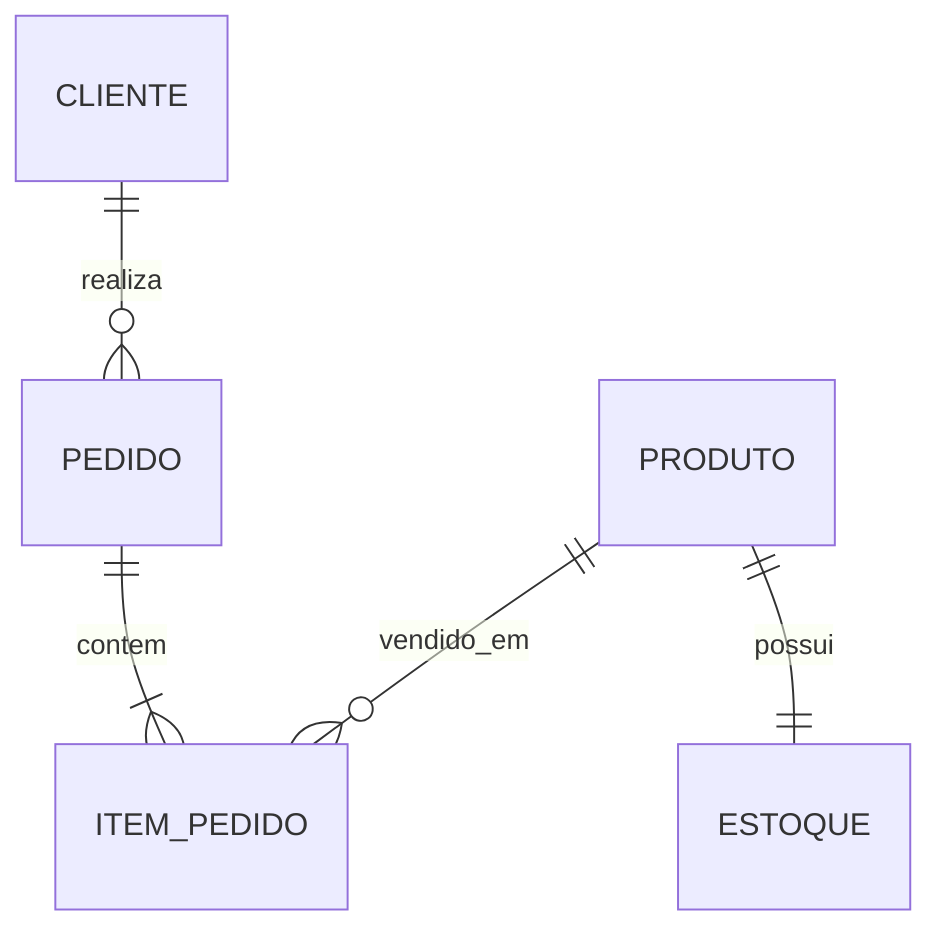

# Entregável da semana 14 — escopo do projeto final

**Tema:** loja virtual de pequeno porte, com vendas e estoque. **Responsável pelo repositório e pela entrega individual:** Álvaro Simeão Castelo Branco. O projeto se limita ao cadastro de clientes e produtos, à criação de pedidos e à baixa de estoque; pagamento eletrônico e logística ficam fora do escopo inicial. Caso o professor determine um grupo para esta etapa, os demais integrantes devem ser acrescentados antes da avaliação em grupo.

## Requisitos funcionais

1. Cadastrar clientes com e-mail único.
2. Cadastrar produtos com SKU e preço não negativo.
3. Consultar produtos e suas quantidades disponíveis.
4. Criar pedidos associados a um cliente e a um ou mais produtos.
5. Registrar a quantidade e o preço praticado de cada item no pedido.
6. Impedir a venda de quantidade superior ao estoque disponível.
7. Consultar histórico de pedidos por cliente.

## Requisitos não funcionais

1. A criação do pedido e a baixa de estoque devem ser atômicas: em caso de falha, nenhuma das duas alterações permanece.
2. Consultas por cliente e data devem usar índice adequado, com tempo de resposta previsível para um catálogo de porte pequeno a médio.
3. Dados de clientes devem ser acessíveis apenas a papéis autorizados no banco.

## Entidades centrais

| Entidade | Atributos principais | Relação |
| --- | --- | --- |
| Cliente | `id`, `nome`, `email` | Um cliente realiza vários pedidos. |
| Produto | `id`, `sku`, `nome`, `preco` | Um produto aparece em vários itens de pedido e tem um registro de estoque. |
| Pedido | `id`, `cliente_id`, `status`, `criado_em` | Um pedido pertence a um cliente e contém vários itens. |
| ItemPedido | `pedido_id`, `produto_id`, `quantidade`, `preco_unitario` | Resolve a relação N:N entre pedido e produto. |
| Estoque | `produto_id`, `quantidade` | Um produto tem no máximo um saldo corrente de estoque. |

## Decisão tecnológica

O banco principal será **PostgreSQL**. Pedido, itens e baixa de estoque precisam de chaves estrangeiras, restrições e uma transação ACID para impedir vendas inconsistentes. O modelo é estável e as consultas combinam clientes, pedidos e produtos. MongoDB seria útil para um catálogo com especificações muito variáveis, mas não é necessário neste escopo. Redis pode acelerar um carrinho temporário futuramente; não substitui o registro definitivo do pedido.

## Diagrama inicial

`init.sql` cria o esquema `loja_backend` e a primeira tabela `produtos`. O `CHECK (preco >= 0)` impede preço negativo. Executar com `psql -d postgres -f init.sql`; as próximas semanas ampliam esse modelo.

## Reflexão

A escolha do SGBD deriva das operações e das garantias exigidas, não da familiaridade da equipe. Selecionar um banco que não ofereça integridade transacional adequada complicaria a baixa de estoque e a recuperação de falhas. Uma escolha inadequada também pode aumentar a quantidade de código de integração, a latência das consultas e o custo de manutenção.

Fonte do enunciado: [AVA — Entregável Semana 14](https://ead.ceuma.br/mod/assign/view.php?id=25610).
